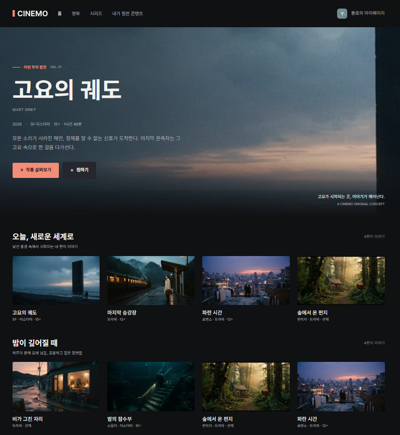
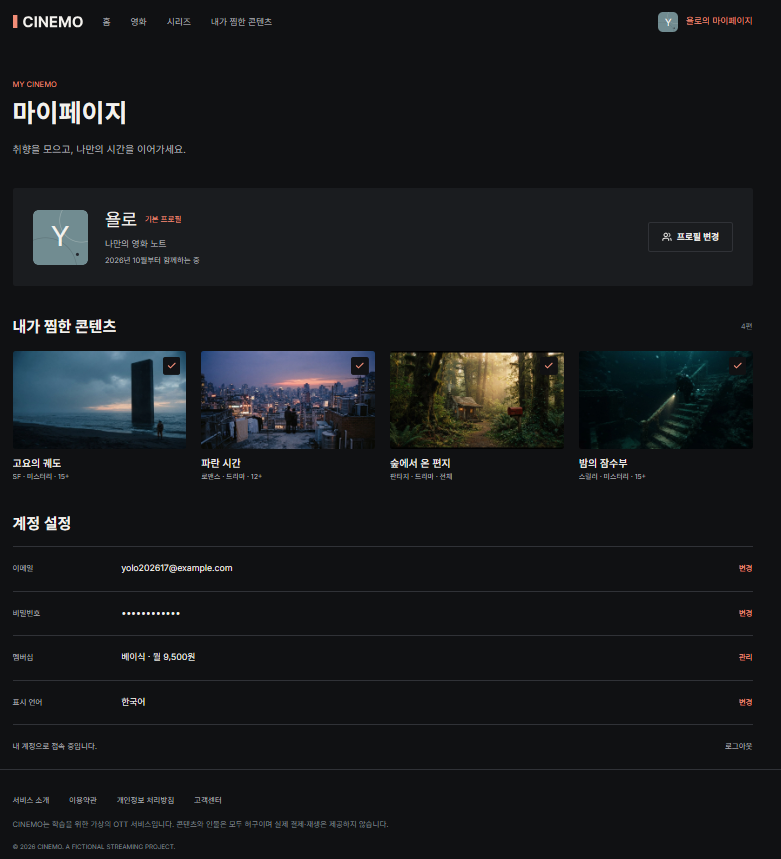

# 5조: 오조의 마법사

## 1. 프로젝트 소개

- **주제:** CINEMO 구현하기
- **기획 의도:** 제공된 Figma 디자인을 참고하여 가상의 OTT 서비스인
  CINEMO 웹사이트를 구현합니다. 팀으로 HTML과 CSS를 활용해 웹사이트를
  제작하고, GitHub를 활용한 협업 과정을 경험합니다.

## 2. 팀원과 담당 역할

---

팀원 | 담당 역할

---

김동민 (팀장) | 마이페이지 하단의 계정 설정 구현,
웹 표준 유효성 검사

조영서 | 공통 스타일 UI, 마이페이지 상단의
프로필 구현

박혜정 | 메인 상단의 히어로 배너 구현

윤지빈 | 메인의 콘텐츠 카드, 마이페이지의
찜한 콘텐츠 구현

김어진 | 프로필 선택 창 구현

---

## 3. 폴더 구조

```text
cinemo-clone
├── assets
│   └── images webp
├── styles
│   ├── reset.css
│   └── style.css
├── index.html
├── mypage.html
├── profile.html
└── README.md
```

## 4. 페이지 구성

- 
- 
- 

## 5. 실행 방법

### 방법 1. GitHub를 통해 VS Code에서 로컬 실행하기

1.  원격 저장소 URL을 복사합니다.\
    원격 저장소: <https://github.com/dongmink010203-art/cinemo-clone>

2.  GitHub 원격 저장소 페이지에서 초록색 **Code** 버튼을 클릭하고 URL을
    복사합니다.

3.  Git Bash를 설치한 뒤 VS Code를 엽니다.

4.  프로젝트를 저장하고 싶은 로컬 폴더 위치로 이동합니다.

5.  다음 클론 명령어를 실행합니다.

    ```bash
    git clone [저장소 URL]
    ```

### 방법 2. 배포 URL로 확인하기

다음 배포 URL에서 프로젝트를 확인할 수 있습니다.

<https://dongmink010203-art.github.io/cinemo-clone/>
